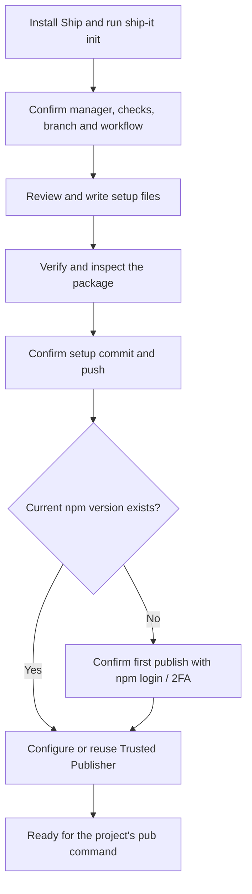
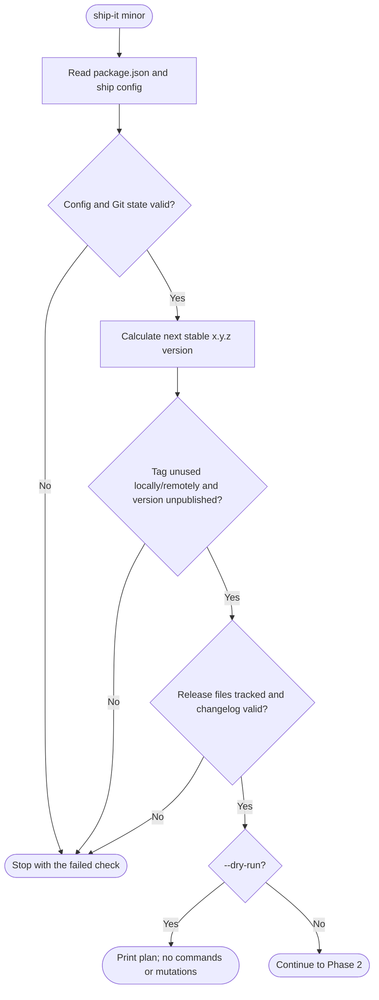
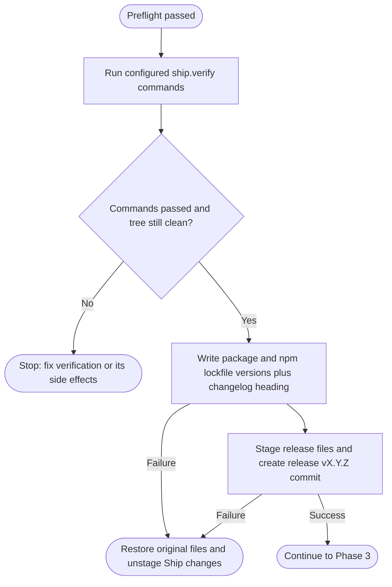
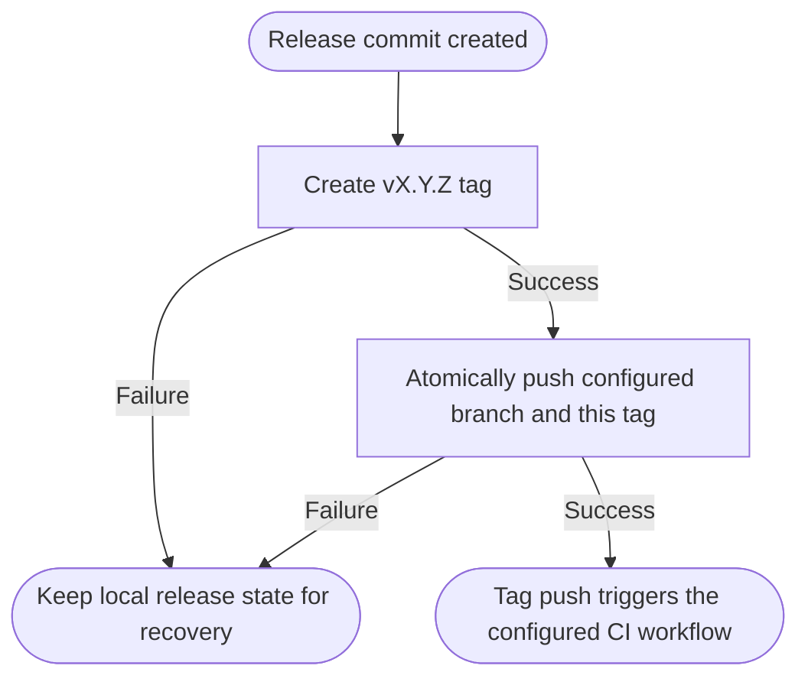
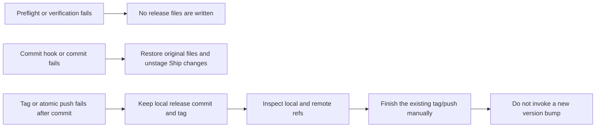
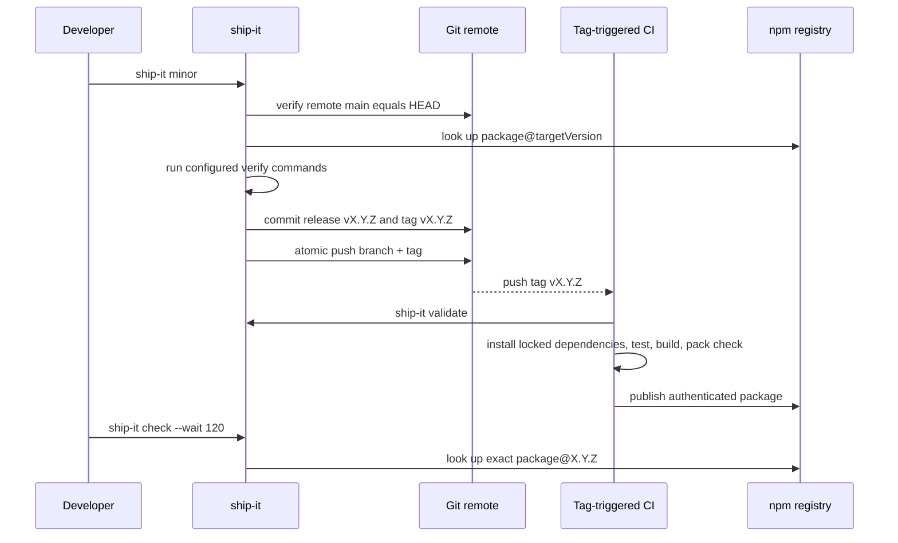
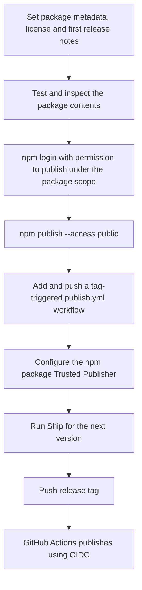

# @atom-forge/ship

`@atom-forge/ship` is a dependency-free release CLI for Node.js 22+ and Bun.
It prepares one npm-style package release locally, then lets CI perform the
actual publish. Ship never guesses a package manager, never calls `npm version`,
and never stores registry credentials.

The goal is a small project configuration and a repeatable, inspectable path
from an Unreleased changelog entry to a CI-triggering Git tag.

## Install

Install an exact published version of `@atom-forge/ship` as a development
dependency using your package manager. For local development, install from its
directory, for example `npm install --save-dev ../ship`.

## Setup wizard

After installing Ship in a project, run:

```sh
npm exec -- ship-it init
# Or with Bun:
bun run ship-it init
```

The wizard is a one-time setup for a single npm package in a GitHub repository.
It asks you to confirm the package manager, its exact CI version, the release
branch, workflow filename, and the commands that should pass before publishing.
It suggests commands from existing `check`, `test`, `prepack` or `build` scripts;
enter a JSON array when you want to change them. Commands can use any tooling.

The wizard then:

1. Sets `pub`, `pub-check` and `pub-validate` scripts, the `ship.verify` commands,
   a matching GitHub repository URL, and public npm publishing settings.
2. Prepares a changelog and a tag-triggered GitHub Actions workflow with locked
   dependency installation, exact tag validation, verification commands, package
   inspection and OIDC publishing.
3. Asks before writing files or replacing a workflow. A replaced workflow is
   preserved as a `.ship-backup` file; old standalone release scripts are retained.
4. Offers to run your verification commands and inspect the package contents.
5. Offers to commit/push only the displayed setup files and dependency lockfiles.
   Unrelated changes or an existing staging area stop this step for manual review.
6. If the current version is not published, offers to stamp its release notes,
   sign in to npm if needed, and perform the first publish. This always requires
   confirmation and uses the existing version rather than bumping it.
7. Creates and verifies the npm Trusted Publisher for the chosen workflow,
   asking before granting the workflow publishing access. Matching existing trust
   is reused. npm may require browser authentication or 2FA. If this challenge
   prevents capturing the publisher list, the wizard displays it interactively
   and asks you to confirm the exact repository, workflow and permissions.



Use `ship-it init --dry-run` for a read-only local suggestion: it makes no network
requests, prompts, file changes, commits, publishes, or trust changes. Interactive
`init` reads registry metadata and requires network access. Declining a later step
keeps the local setup so you can resume by running `init` again; failures also keep
the prepared files and any completed remote operations rather than undoing them.

Requirements: an existing Git repository with a GitHub remote and at least one
commit, an installed Ship dependency, and an npm account with publishing rights.
Commit source changes first; the wizard can include the dependency's manifest and
lockfile changes, but will not silently commit unrelated source files. For new
packages, choose and apply a license before the first publish.

The chosen package manager needs a committed lockfile for CI (npm, Bun, pnpm or
Yarn Classic). Ship itself skips installation because it has no dependencies.
Cross-repository `file:`/`link:` dependencies require custom CI checkout steps;
replace them with registry dependencies before using the generated workflow.
The local npm CLI must be at least 11.15.0 for Trusted Publisher management. The
wizard does not upgrade tools globally, install private-dependency credentials,
change GitHub Actions policies, or bypass npm's account authentication.

The wizard is currently in the repository; npm version `0.1.0` does not include
it. Until the next Ship release, use a local checkout to try it.

## Manual configuration

```json
{
  "scripts": {
    "pub": "ship-it",
    "pub-check": "ship-it check"
  },
  "ship": {
    "verify": ["npm test", "npm run build"]
  }
}
```

Use any project commands: `bun run prepack`, `pnpm test`, `make check`, etc. Commands run in the repository root using the system shell. Only configure trusted commands.

The executable uses Node by default. To explicitly use Bun, invoke `bun ./node_modules/@atom-forge/ship/bin/ship-it.js`.

## Commands

```sh
ship-it                    # patch
ship-it init
ship-it init --dry-run
ship-it minor
ship-it major
ship-it 2.0.0
ship-it minor --dry-run
ship-it check
ship-it check --wait 120
ship-it validate --tag v1.2.3
```

Ship releases stable `x.y.z` versions. Prereleases, monorepo workspaces, automatic dependency upgrades and non-npm registries are outside this initial version's scope. It operates on one npm-format package at the Git repository root. Registry checks use public HTTP metadata, without npm credentials. Publishing itself belongs to CI.

## Configuration

Optional `package.json.ship` fields:

| Field | Default | Purpose |
| --- | --- | --- |
| `verify` | `[]` | Ordered shell commands; failure blocks release |
| `branch` | `main` | Required release branch |
| `remote` | `origin` | Git remote for branch/tag checks and push |
| `tagPrefix` | `v` | Release tag prefix |
| `changelog` | `CHANGELOG.md` | Tracked changelog inside the project |
| `registry` | `https://registry.npmjs.org` | Public npm-compatible metadata endpoint |

Unknown settings are rejected. Set `verify` explicitly for your project; Ship does not assume a build or test script exists.

## What happens during a release

### Phase 1 — Preflight and release plan

Ship checks the package configuration, repository root, clean Git state and
release branch. It then calculates the target version, checks local/remote tags
and the registry, and validates the tracked release files and Unreleased notes.
Any failure stops the release before Ship writes files.



### Phase 2 — Verification and release commit

Ship runs the configured commands, checks that the working tree is still clean,
then writes and commits the release metadata. If writing, staging or committing
fails before the commit succeeds, it restores its release files and clears their
staging.



### Phase 3 — Tag and atomic push

Ship creates the release tag and pushes the branch and only that tag together.
A configured publish workflow can then start in CI. A tag or push failure keeps
the local release commit and any created tag for manual recovery.



### Local responsibilities

`ship-it` performs only the local, reviewable parts of a release:

1. Reads the package version and `ship` configuration.
2. Requires a clean repository on the configured remote-equivalent branch.
3. Ensures the target version and tag are unused, and that the exact version is absent from the registry.
4. Requires a real `## [Unreleased]` changelog section, then runs the configured validation commands.
5. Writes the version to `package.json`; if present, it also updates the root version in `package-lock.json` or `npm-shrinkwrap.json`.
6. Stamps the changelog, commits as `release vX.Y.Z`, creates the tag, and atomically pushes that commit and that tag.

Ship does not build by assumption: builds, tests, packaging checks and generated
files belong in `ship.verify`. Ship does not publish: the tag-triggered CI job
owns credentials, provenance and `npm publish`.

### Failure and recovery behavior



If the commit fails, Ship restores only the release files it changed and clears
their staging. Existing Git hooks are honored. If tagging or pushing fails after
the commit, Ship preserves the local commit because undoing an already-created
release commit automatically could destroy useful recovery state.

## CI after the tag push



## Internal module map

The library facade remains [src/ship.js](src/ship.js). The implementation is
split by responsibility so each part can change independently:

| Module | Responsibility |
| --- | --- |
| `cli.js` | Parses and routes CLI commands |
| `release.js` | Coordinates release, check, and CI validation use cases |
| `project.js` | Loads and validates the package manifest/configuration |
| `version.js` | Validates and calculates stable versions |
| `changelog.js` | Validates and stamps changelog sections |
| `git.js` | Checks Git state and performs the atomic push |
| `registry.js` | Queries the exact package version from the registry |
| `files.js` | Snapshots, updates, and restores release metadata files |
| `verify.js` | Runs the project's configured verification commands |
| `init.js` | Coordinates interactive local setup, bootstrap publish and trusted publisher setup |
| `init-plan.js` | Suggests project settings and prepares manifest/changelog content |
| `workflow.js` | Generates the project's GitHub Actions publishing workflow |
| `prompts.js` | Terminal questions and confirmations for the wizard |

## Command details

`--dry-run` performs read-only preflight checks and prints the release plan; it does not execute verification commands, modify files, commit, tag or push. It requires network access to the remote and registry.

`check` queries the exact package version, independently of the `latest` dist-tag. `--wait` retries missing versions for up to the supplied seconds (maximum 3600); network/authentication/server errors fail immediately.

`validate` checks tag/package/changelog agreement without mutations. It takes the tag from `--tag`, `GITHUB_REF_NAME`, or an exact local tag, in that order.

## CI integration

Keep `publish.yml` in each package repository. Its release job should check out the tag, install pinned tools and locked dependencies, run `ship-it validate`, run the project's tests/build, inspect the packed artifact, and publish via the registry's supported authentication mechanism. Ship does not publish or configure Trusted Publishing.

### First publish and Trusted Publishing setup

This setup is required once per new npm package. The package must exist on npm
before you can configure its Trusted Publisher in the package settings. Make
the first publish interactively, then connect the package to GitHub Actions for
future releases. Ship's own first version is `0.1.0`.



For the first Ship publish:

1. Confirm that the npm account can publish under the `@atom-forge` scope.
2. Prepare the `0.1.0` changelog entry and commit the release metadata. Ship's
   normal release command increments the version, so do not use it to publish
   the existing `0.1.0` version.
3. Run these commands from the Ship repository root. Ship has no build step or
   external dependencies; other projects must run their own build before packing.

```sh
npm test
npm pack --dry-run --ignore-scripts
npm login
npm publish --access public
```

4. Add `.github/workflows/publish.yml`, commit it, and push it to GitHub. The
   workflow must run on release tag pushes, use a GitHub-hosted runner, grant
   `id-token: write` and `contents: read`, and publish using a compatible npm CLI.
   Trusted Publishing requires npm 11.5.1+ and Node 22.14.0+.
5. On npmjs.com, open `@atom-forge/ship` → **Settings → Trusted publishing** and
   add a **GitHub Actions** publisher with the following fields:

| npm publisher field | Value for Ship |
| --- | --- |
| Organization or user | `atom-forge` |
| Repository | `ship` |
| Workflow filename | `publish.yml` (filename only) |
| Environment name | Leave empty unless the workflow explicitly uses a GitHub environment |
| Allowed actions | Enable direct `npm publish` for this workflow |

Direct publishing must be explicitly permitted: a publisher configured only for
`npm stage publish` will not authorize this project's direct publish command.
The package's `repository.url` must also identify the same GitHub repository.

6. Once the workflow and publisher are configured, use `npm run pub` for the
   next Ship version (by default `0.1.1`), then `npm run pub-check -- --wait 120`
   to confirm publication. Write the next changes under `## [Unreleased]` first.

Ship includes a tag-triggered `.github/workflows/publish.yml`. It validates the
release tag, tests on Node and Bun, inspects the package, and publishes using
OIDC. The workflow pins npm 11.16.0 and Bun 1.4.0 and uses Node 24. It needs no
dependency installation or build step because Ship has no external dependencies.
The npm Trusted Publisher still needs to be configured for the exact repository
and workflow. Ship's preflight checks cannot confirm these settings or CI success.

The Ship repository is private. npm Trusted Publishing supports this, but npm
does not generate provenance for private repositories; the workflow therefore
does not force `--provenance`. It does not require an npm publish-token secret.
See the [npm Trusted Publishing documentation](https://docs.npmjs.com/trusted-publishers/)
for the current provider requirements and settings.

For Bun-based packages, the relevant commands after setup are:

```sh
bun install --frozen-lockfile
bun ./node_modules/@atom-forge/ship/bin/ship-it.js validate
bun run prepack
npm pack --dry-run --ignore-scripts
npm publish --access public --ignore-scripts
```

For TypeScript libraries, replace `prepack` with the appropriate build command. Keep required tests/type checks before publication. Migrating existing repositories is a separate step.

## Development

```sh
node --test
bun test
node bin/ship-it.js --help
```

Integration tests use disposable local Git repositories and an in-process registry fixture. They never publish packages or push to external remotes.

This project is licensed under MIT; see [LICENSE](LICENSE). Version `0.1.0` is
published on npm. Future releases use the included publishing workflow after the
npm Trusted Publisher is configured.
