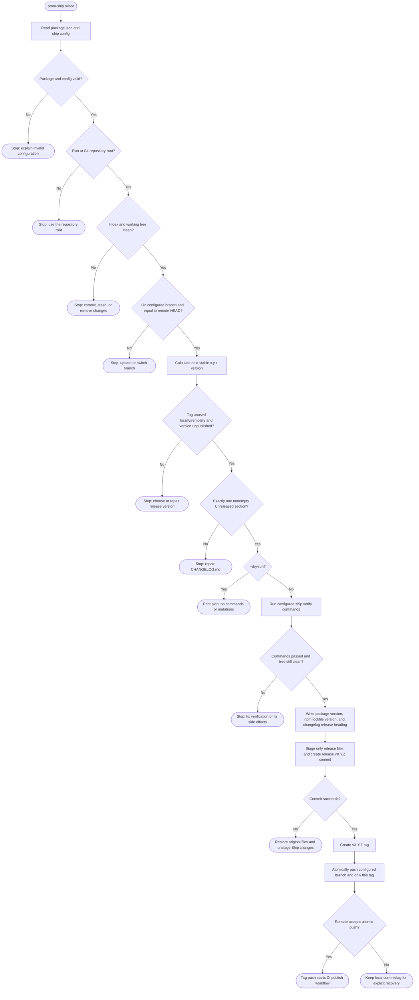
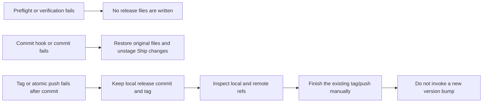
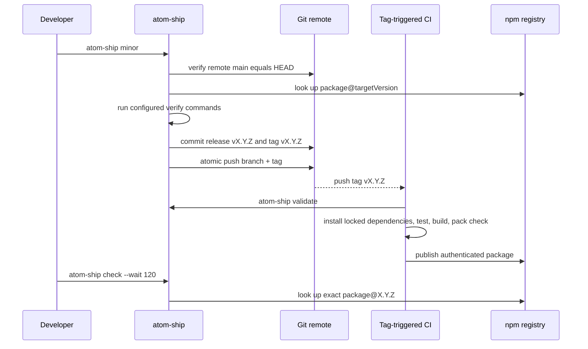
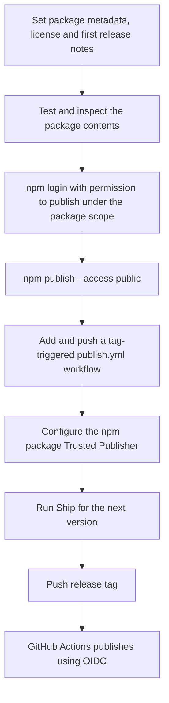

# @atom-forge/ship

`@atom-forge/ship` is a dependency-free release CLI for Node.js 22+ and Bun.
It prepares one npm-style package release locally, then lets CI perform the
actual publish. Ship never guesses a package manager, never calls `npm version`,
and never stores registry credentials.

The goal is a small project configuration and a repeatable, inspectable path
from an Unreleased changelog entry to a CI-triggering Git tag.

## Install

Until this package is published, install it from its local directory using your package manager, for example `npm install --save-dev ../ship`. After publication, pin an exact version of `@atom-forge/ship` as a development dependency.

```json
{
  "scripts": {
    "pub": "atom-ship",
    "pub-check": "atom-ship check"
  },
  "ship": {
    "verify": ["npm test", "npm run build"]
  }
}
```

Use any project commands: `bun run prepack`, `pnpm test`, `make check`, etc. Commands run in the repository root using the system shell. Only configure trusted commands.

The executable uses Node by default. To explicitly use Bun, invoke `bun ./node_modules/@atom-forge/ship/bin/atom-ship.js`.

## Commands

```sh
atom-ship                    # patch
atom-ship minor
atom-ship major
atom-ship 2.0.0
atom-ship minor --dry-run
atom-ship check
atom-ship check --wait 120
atom-ship validate --tag v1.2.3
```

Ship releases stable `x.y.z` versions. Prereleases, monorepo workspaces, automatic dependency upgrades and non-npm registries are outside this initial version's scope. It operates on one npm-format package at the Git repository root. Registry checks use public HTTP metadata, without npm credentials. Publishing itself belongs to CI.

## Configuration

Optional `package.json.ship` fields:

| Field | Default | Purpose |
| --- | --- | --- |
| `verify` | `[]` | Ordered shell commands; failure blocks release |
| `branch` | `main` | Required release branch |
| `remote` | `origin` | Git remote for branch/tag checks and push |
| `tagPrefix` | `v` | Release tag prefix |
| `changelog` | `CHANGELOG.md` | Tracked changelog inside the project |
| `registry` | `https://registry.npmjs.org` | Public npm-compatible metadata endpoint |

Unknown settings are rejected. Set `verify` explicitly for your project; Ship does not assume a build or test script exists.

## What happens during a release



### Local responsibilities

`atom-ship` performs only the local, reviewable parts of a release:

1. Reads the package version and `ship` configuration.
2. Requires a clean repository on the configured remote-equivalent branch.
3. Ensures the target version and tag are unused, and that the exact version is absent from the registry.
4. Requires a real `## [Unreleased]` changelog section, then runs the configured validation commands.
5. Writes the version to `package.json`; if present, it also updates the root version in `package-lock.json` or `npm-shrinkwrap.json`.
6. Stamps the changelog, commits as `release vX.Y.Z`, creates the tag, and atomically pushes that commit and that tag.

Ship does not build by assumption: builds, tests, packaging checks and generated
files belong in `ship.verify`. Ship does not publish: the tag-triggered CI job
owns credentials, provenance and `npm publish`.

### Failure and recovery behavior



If the commit fails, Ship restores only the release files it changed and clears
their staging. Existing Git hooks are honored. If tagging or pushing fails after
the commit, Ship preserves the local commit because undoing an already-created
release commit automatically could destroy useful recovery state.

## CI after the tag push



## Internal module map

The library facade remains [src/ship.js](src/ship.js). The implementation is
split by responsibility so each part can change independently:

| Module | Responsibility |
| --- | --- |
| `cli.js` | Parses and routes CLI commands |
| `release.js` | Coordinates release, check, and CI validation use cases |
| `project.js` | Loads and validates the package manifest/configuration |
| `version.js` | Validates and calculates stable versions |
| `changelog.js` | Validates and stamps changelog sections |
| `git.js` | Checks Git state and performs the atomic push |
| `registry.js` | Queries the exact package version from the registry |
| `files.js` | Snapshots, updates, and restores release metadata files |
| `verify.js` | Runs the project's configured verification commands |

## Command details

`--dry-run` performs read-only preflight checks and prints the release plan; it does not execute verification commands, modify files, commit, tag or push. It requires network access to the remote and registry.

`check` queries the exact package version, independently of the `latest` dist-tag. `--wait` retries missing versions for up to the supplied seconds (maximum 3600); network/authentication/server errors fail immediately.

`validate` checks tag/package/changelog agreement without mutations. It takes the tag from `--tag`, `GITHUB_REF_NAME`, or an exact local tag, in that order.

## CI integration

Keep `publish.yml` in each package repository. Its release job should check out the tag, install pinned tools and locked dependencies, run `atom-ship validate`, run the project's tests/build, inspect the packed artifact, and publish via the registry's supported authentication mechanism. Ship does not publish or configure Trusted Publishing.

### First publish and Trusted Publishing setup

This setup is required once per new npm package. The package must exist on npm
before you can configure its Trusted Publisher in the package settings. Make
the first publish interactively, then connect the package to GitHub Actions for
future releases. Ship's own first version is `0.1.0`.



For the first Ship publish:

1. Confirm that the npm account can publish under the `@atom-forge` scope.
2. Prepare the `0.1.0` changelog entry and commit the release metadata. Ship's
   normal release command increments the version, so do not use it to publish
   the existing `0.1.0` version.
3. Run these commands from the Ship repository root. Ship has no build step or
   external dependencies; other projects must run their own build before packing.

```sh
npm test
npm pack --dry-run --ignore-scripts
npm login
npm publish --access public
```

4. Add `.github/workflows/publish.yml`, commit it, and push it to GitHub. The
   workflow must run on release tag pushes, use a GitHub-hosted runner, grant
   `id-token: write` and `contents: read`, and publish using a compatible npm CLI.
   Trusted Publishing requires npm 11.5.1+ and Node 22.14.0+.
5. On npmjs.com, open `@atom-forge/ship` → **Settings → Trusted publishing** and
   add a **GitHub Actions** publisher with the following fields:

| npm publisher field | Value for Ship |
| --- | --- |
| Organization or user | `atom-forge` |
| Repository | `ship` |
| Workflow filename | `publish.yml` (filename only) |
| Environment name | Leave empty unless the workflow explicitly uses a GitHub environment |
| Allowed actions | Enable direct `npm publish` for this workflow |

Direct publishing must be explicitly permitted: a publisher configured only for
`npm stage publish` will not authorize this project's direct publish command.
The package's `repository.url` must also identify the same GitHub repository.

6. Once the workflow and publisher are configured, use `npm run pub` for the
   next Ship version (by default `0.1.1`), then `npm run pub-check -- --wait 120`
   to confirm publication. Write the next changes under `## [Unreleased]` first.

The repository currently contains only the test workflow; this setup section
does not install a publish workflow or configure the npm account. Ship's
preflight checks cannot confirm the Trusted Publisher settings or CI success.
See the [npm Trusted Publishing documentation](https://docs.npmjs.com/trusted-publishers/)
for the current provider requirements and settings.

For Bun-based packages, the relevant commands after setup are:

```sh
bun install --frozen-lockfile
bun ./node_modules/@atom-forge/ship/bin/atom-ship.js validate
bun run prepack
npm pack --dry-run --ignore-scripts
npm publish --access public --ignore-scripts
```

For TypeScript libraries, replace `prepack` with the appropriate build command. Keep required tests/type checks before publication. Migrating existing repositories is a separate step.

## Development

```sh
node --test
bun test
node bin/atom-ship.js --help
```

Integration tests use disposable local Git repositories and an in-process registry fixture. They never publish packages or push to external remotes.

This project is licensed under MIT; see [LICENSE](LICENSE). It is not yet published. A hosted publishing workflow must be set before automated releases.
