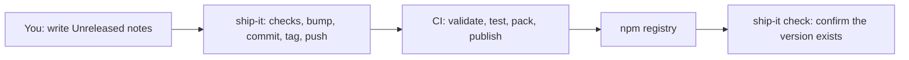

# Overview

## Purpose

Publishing a package safely involves many small steps: clean tree, right branch, unused tag, unpublished version, passing tests, a changelog entry, a version bump, a commit, a tag, and a push that CI can react to. Ship performs the **local, reviewable** part of that sequence the same way every time.

Ship deliberately stays small:

- It never guesses a package manager and never calls `npm version`.
- It never stores registry credentials and never runs `npm publish`.
- It has no runtime dependencies.

## Who does what

| Responsibility | Owner |
|---|---|
| Release notes under `## [Unreleased]` | You |
| Preflight, version bump, changelog stamp, commit, tag, atomic push | `ship-it` |
| Tests, builds, packaging checks | Commands you list in `ship.verify` |
| Credentials, provenance, `npm publish` | Tag-triggered CI |

## Scope

Ship releases **stable `x.y.z` versions** of **one npm-format package at the Git repository root**. These are out of scope: prereleases, monorepo workspaces, automatic dependency upgrades, and non-npm registries.

## Installation

Install an exact published version as a development dependency with your package manager. To try a local checkout, install from its directory, for example `npm install --save-dev ../ship`.

Requirements for releasing: Node.js 22+ (or Bun), a Git repository with a remote, and a tracked `package.json` and changelog.

## Library surface

Ship's package export is a small facade that provides `main` (the CLI entry), `stampChangelog` and `nextVersion`. Most projects only use the `ship-it` executable.

> [!tip] Ship does not build
> Builds, tests, type checks and generated files are your responsibility. List them in `ship.verify` and Ship runs them in order before it changes any file.
