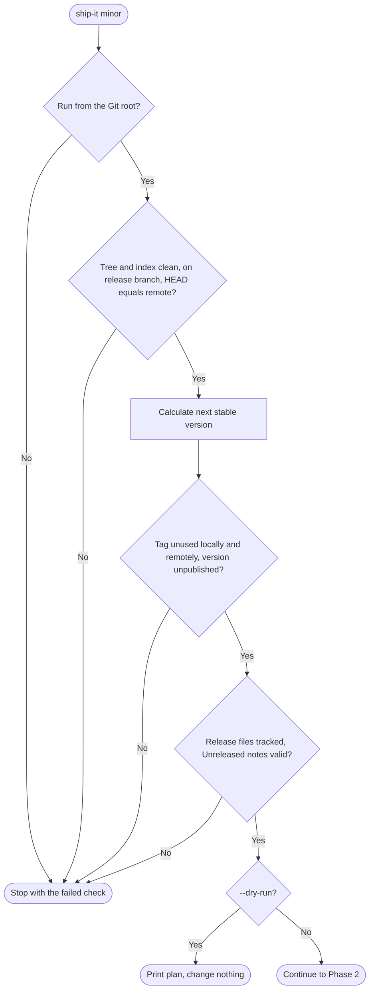
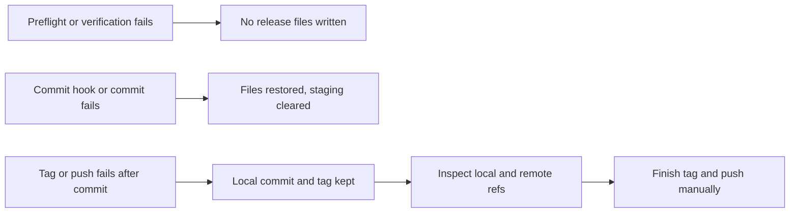

# Release flow

A release has three phases. Everything that can fail cheaply happens first, before Ship writes any file.

## Before you start

Write your notes under a real `## [Unreleased]` heading in the changelog:

```md
## [Unreleased]

### Added
- Add a widget export.
```

Ship needs exactly one such heading with non-empty content. Empty `---` separators and `###` headings alone do not count as notes.

## Phase 1 — Preflight and release plan



The checks, in order: repository root, clean working tree **including untracked files**, configured branch, local `HEAD` equal to the remote branch, a valid and increasing target version, an unused tag (local and remote), a version that is not yet on the registry, tracked release files, and a valid Unreleased section.

## Phase 2 — Verification and release commit

1. Ship runs each `ship.verify` command in order and stops on the first failure.
2. It checks again that the tree is clean, so a command that generates or modifies tracked files is caught here.
3. It writes the new `version` into `package.json` and, if present, the root version of `package-lock.json` or `npm-shrinkwrap.json`, preserving the file's indentation.
4. It stamps the changelog and commits all release files as `release vX.Y.Z`.

Stamping inserts a fresh, empty `## [Unreleased]` heading and a dated heading above your notes:

```md
## [Unreleased]

## [1.5.0] - 2026-10-15

### Added
- Add a widget export.
```

If writing, staging or committing fails, Ship restores the original file contents and clears the staging of its release files. Your Git hooks still run on the commit.

## Phase 3 — Tag and atomic push

Ship creates the `vX.Y.Z` tag and pushes the branch and **only that tag** in one `git push --atomic`. Either both refs update or neither does. The tag push is the signal that starts CI.

## Failure and recovery



| Where it failed | State left behind | What to do |
|---|---|---|
| Preflight or verification | Nothing written | Fix the reported problem, run again |
| Writing, staging or committing | Original files restored | Fix the cause (for example a hook), run again |
| Tagging or pushing | Release commit and possibly the tag kept | Inspect refs and finish by hand |

> [!danger] Never bump again after a late failure
> If the release commit already exists, running `ship-it` again would release the *next* version and skip the one you meant to ship. Ship keeps the commit on purpose, because discarding a release commit automatically could destroy useful recovery state. Inspect `git log`, `git tag` and `git ls-remote --tags origin`, then complete the existing tag and push.

## What Ship does not do

It does not publish, build, or configure Trusted Publishing, and it cannot confirm that CI succeeded. Use `ship-it check --wait` afterwards to confirm that the version reached the registry.
