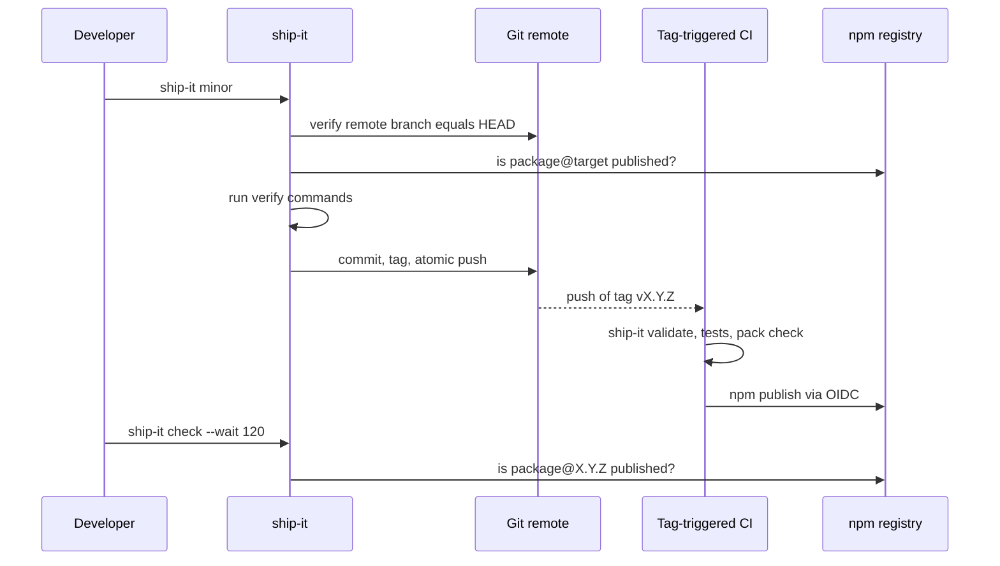
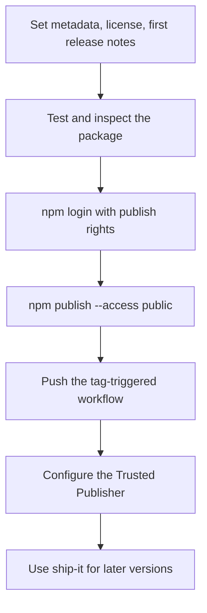

# Setup and CI

Ship prepares the release; CI publishes it. This chapter covers the one-time setup of a package and what runs after the tag push.

## The CI half of a release



## The setup wizard

For a single npm package in a GitHub repository, run the wizard once after installing Ship:

```sh
npm exec -- ship-it init
# or with Bun:
bun run ship-it init
```

It asks you to confirm the package manager, its exact CI version, the release branch, the workflow filename and the verification commands. Commands are suggested from existing `check`, `test`, `prepack` or `build` scripts; enter a JSON array to change them.

Then it can:

1. Set the `pub`, `pub-check` and `pub-validate` scripts, `ship.verify`, a matching GitHub `repository` URL and public publish settings.
2. Prepare the changelog and a tag-triggered workflow with locked installs, tag validation, your verify commands, package inspection and OIDC publishing.
3. Verify and inspect the package, then offer a commit and push of only the displayed setup files and lockfiles.
4. Offer the first publish when the current version is not on npm.
5. Create or reuse the npm Trusted Publisher for the workflow.

Every step that writes files, commits, publishes or changes npm trust asks first. Declining a step keeps the local setup, and running `init` again resumes. A replaced workflow is kept as a `.ship-backup` file.

> [!tip] Preview without side effects
> `ship-it init --dry-run` prints a local suggestion. It makes no network requests, prompts, file changes, commits, publishes or trust changes.

Requirements: a Git repository with a GitHub remote and at least one commit, Ship installed, a committed lockfile for your package manager (npm, Bun, pnpm or Yarn Classic), npm CLI 11.15.0 or newer for Trusted Publisher management, and an account that may publish the package. Unrelated uncommitted changes or a non-empty staging area stop the commit step so you can review them.

## The generated workflow

The workflow runs on pushes of tags matching `<tagPrefix>*` and has two permissions: `contents: read` and `id-token: write`. Its steps:

1. Check out the tag without persisting credentials.
2. Set up Node 24 and an exact npm version that supports Trusted Publishing.
3. Install the chosen package manager at its exact version, then install locked dependencies.
4. Run `pub-validate` (that is, `ship-it validate`) so the tag, version and changelog agree.
5. Run your `ship.verify` commands.
6. Run `npm pack --dry-run --ignore-scripts`.
7. Run `npm publish --access public --ignore-scripts`.

No npm token secret is needed; npm authenticates the job through OIDC.

> [!warning] Cross-repository dependencies
> `file:` and `link:` dependencies on other repositories need custom checkout steps. Replace them with registry dependencies before using the generated workflow.

## First publish and Trusted Publishing

A new package must exist on npm before its Trusted Publisher can be configured, so the first publish is interactive.



The first publish uses the version already in `package.json`; do not use `ship-it` for it, because Ship always increments the version. Prepare a stamped changelog entry for that version, then:

```sh
npm test
npm pack --dry-run --ignore-scripts
npm login
npm publish --access public
```

On npmjs.com, under the package's **Settings → Trusted publishing**, add a GitHub Actions publisher:

| npm field | Value |
|---|---|
| Organization or user | The GitHub owner, for example `acme` |
| Repository | The repository name, for example `widget` |
| Workflow filename | The filename only, for example `publish.yml` |
| Environment name | Empty, unless the workflow uses a GitHub environment |
| Allowed actions | Direct `npm publish` enabled |

> [!warning] Direct publish must be allowed
> A publisher configured only for staged publishing will not authorize the workflow's direct `npm publish`. The `repository.url` in `package.json` must also identify the same GitHub repository.

Trusted Publishing needs npm 11.5.1+ and Node 22.14.0+. npm generates provenance automatically only for public repositories; the workflow does not force `--provenance`.

> [!note] The wizard can do this for you
> The wizard offers the first publish and the Trusted Publisher step. The manual path above is useful when you want to understand or repeat it.
